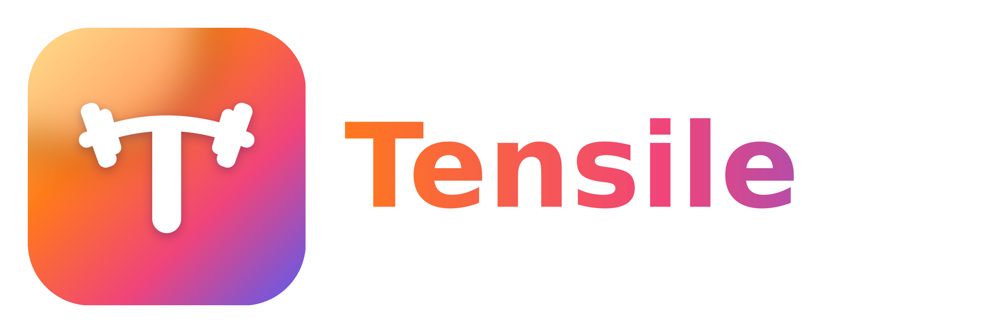

# Tensile



An iPhone app in the style of Bevel: **Strain, Recovery and Sleep** scores from Apple Health, an **AI coach** you can chat with, plus a full **gym workout tracker** whose sessions count toward strain.

> The app is called **Tensile** (the repo and Xcode project keep the name WorkoutApp). The logo is a "T" made from a loaded barbell whose bar flexes under the weight; regenerate the icons with `python3 docs/brand/make_logo.py`. Before shipping, run a proper trademark search on the name. Don't use Bevel's or Whoop's name, logo or artwork.

## What's in v0.1

| Area | What it does |
|---|---|
| **Home** | Strain, Recovery and Sleep rings with a coaching line; **strain goal** card showing how far you are from today's target and the workouts that would close the gap; energy balance (Cronometer intake vs. estimated calories burned) and macros; health monitor tiles (RHR, HRV, breathing rate, sleep) |
| **Fitness** | Week strip of daily strain, big strain gauge with today's target band and encouragement, cardio and muscular **training load** (7-day vs 28-day), today's activities (logged lifts plus Garmin/other workouts), heart-rate zones, history |
| **Trainer** | **My Gym**: your equipment, bar weights, plate pairs, dumbbell/kettlebell sets and machine/cable increments. The workout builder picks exercises you can do there, sets reps and effort from your recovery, and suggests weights from your lift history **rounded to what you can actually load**, progressing by your gym's smallest jump. Swap any exercise; see plate loading per side |
| **Live workout** | Timer, live strain added, rest pill (−15s/+15s/Skip), previous sets, "New PR" badges, plate-loading hints, finished and upcoming exercises collapsed |
| **Coach** | Chat that knows your scores, food, calories, gym and lifts; training questions come back with a ready-to-start workout card. On-device (Apple Intelligence) or Claude |
| **Progress photos** | Daily front and side photos kept only inside the app (encrypted, never in the Photos library), a before/after slider and timeline, and a weekly Claude analysis (`supabase/functions/progress`) that relates visible changes to your goal, weight trend, calories, protein and training |
| **Biology** | 90-day HRV baseline chart plus every stat Apple Health has: resting, sleeping and walking heart rate, heart-rate recovery (measured after workouts), a heart-rate stress estimate, VO₂ max, blood oxygen, respiration, temperature, mindful minutes, steps, distance, floors, intensity minutes, active/resting energy, weight, body fat, BMI, lean mass, blood pressure, water and protein |

### Calories burned (`EnergyCalculator`)

Resting energy uses **Katch-McArdle** when Apple Health has your body-fat % (better for lean, muscular people), otherwise **Mifflin-St Jeor** (height, weight, age, sex). Exercise uses the **Keytel et al. (2005)** heart-rate equation for minutes when your heart rate is clearly raised, with a MET-based floor for logged lifting sessions (heart rate swings during lifting). Everyday movement comes from steps outside workouts, and digestion adds ~10% of what you ate. HRV isn't part of any validated energy equation, so it isn't used. Expect roughly ±10–15% error, like any wearable estimate.

### How the scores work (`Packages/AppCore`)

- **Strain (0-100%)**: cardio load from heart rate (Banister TRIMP), plus **lifting load** = session RPE x minutes (Foster sRPE). A gym session counts as whichever is higher, its heart-rate load or its RPE load, so lifting isn't undercounted and nothing is counted twice. Load maps onto 0-100% with a curve that flattens near the top.
- **Recovery (0-100%)**: last night's HRV and resting heart rate compared with your own 30-day baseline (z-scores), plus sleep. Needs about 4 nights of data to calibrate.
- **Sleep (0-100)**: time asleep vs. need (need goes up after hard days), efficiency, deep + REM share, interruptions. Overlapping iPhone/Watch records are merged.

These are our own formulas from published sports-science methods, not Whoop's or Bevel's (theirs aren't public). Tune the constants in `StrainCalculator`, `RecoveryCalculator` and `SleepCalculator`; the tests in `Packages/AppCore/Tests` show the expected ranges.

## Run it on your iPhone (Mac + Xcode)

You need Xcode 26 or later, an iPhone on iOS 26+, and your Apple Developer account.

```bash
git clone https://github.com/08xavstj/WorkoutApp.git
cd WorkoutApp
brew install xcodegen
xcodegen generate
open WorkoutApp.xcodeproj
```

Before opening Xcode, set your signing once (HealthKit needs your own team and a unique bundle ID):

```bash
scripts/set-signing.sh <TEAM_ID> com.yourname.workoutapp
```

Your Team ID is the 10-character code at [developer.apple.com/account](https://developer.apple.com/account) → **Membership details**. It's saved in `Config/Signing.local.xcconfig` (not committed), so it survives `xcodegen generate` and `git pull`. Don't set the team in Xcode's Signing tab: regenerating the project resets it.

Then in Xcode:
1. Plug in your iPhone (or use Wi-Fi debugging), pick it as the run destination, press **Run**.
2. If Xcode shows a signing error, open **Signing & Capabilities**, check that *Automatically manage signing* is on and the team is your paid membership (not "Personal Team"), and click **Try Again**.
3. On the phone: allow Apple Health access when asked. Wear your watch to bed for a few nights so recovery can build a baseline.

The `.xcodeproj` is generated, so it isn't committed. Re-run `xcodegen generate` after pulling changes that add files.

Run the score tests any time: `swift test --package-path Packages/AppCore`.

## Connect a Garmin watch

The app reads everything through Apple Health, so it works with Garmin watches (like the Instinct 2) as well as Apple Watch.

1. In the **Garmin Connect** app: **More → Settings → Connected Apps → Apple Health**, and turn on every category.
2. On your iPhone: **Settings → Health → Data Access & Devices → Garmin Connect**, and allow all categories.
3. Open Garmin Connect once a day (or leave it running in the background) so it syncs to Health.

What comes through: heart rate, resting heart rate, sleep and stages, and workouts. That covers strain and sleep.

What doesn't: **HRV**. Garmin keeps HRV Status in its own app. Without it, recovery is based on resting heart rate and sleep only. To include HRV, tap **Add HRV** on the Recovery card each morning and type last night's average from Garmin Connect (HRV Status). Health HRV is used instead whenever it exists.

Gym sessions: log them in this app. If you also start a Strength activity on the watch, turn off **Save to Apple Health** when you finish, so Health doesn't get the workout twice. Garmin's in-workout heart rate sometimes reaches Health only as a summary, which is why lifting strain is driven by your effort rating.

## Connect Cronometer

Cronometer has no public API (it only gives API access to selected partners), but it can write your food log to Apple Health, and this app reads it from there.

1. In the Cronometer app, open its settings, find **Apple Health** under connected apps/devices, and turn on **exporting nutrition** to Health.
2. On your iPhone, open **Settings → Health → Data Access & Devices → Cronometer** and check that it's allowed to *write* Energy Consumed, Protein, Carbohydrates, Fat, Fiber and Water.
3. In WorkoutApp, allow it to *read* those same types (asked on first launch, or **Settings → Review Health access**).

Food you log shows up on the Today screen and the coach uses it. For example, it can tell you that you ate too little protein after a high-strain day. If Cronometer doesn't send a nutrient (some users report carbs or fiber dropping out), that field shows "--".

## Turn on the Claude coach (optional)

The on-device coach works with no setup on iPhones that support Apple Intelligence. For Claude:

1. Create a Supabase project (or use an existing one). In **Authentication → Sign In / Providers**, turn on **Allow anonymous sign-ins**.
2. Install the Supabase CLI (`brew install supabase/tap/supabase`), then from this repo:
   ```bash
   supabase link --project-ref <your-project-ref>
   supabase secrets set ANTHROPIC_API_KEY=sk-ant-...
   supabase functions deploy coach
   supabase functions deploy progress   # weekly progress-photo analysis
   ```
3. In the app: **Settings → AI coach → Claude**, paste your project URL and anon key.

The function uses `claude-opus-5-5` at low effort (change `MODEL` and `effort` in `supabase/functions/coach/index.ts`). Every user signs in anonymously, so before you share the app widely, add rate limiting or Sign in with Apple. Anyone with the anon key could otherwise run up your Anthropic bill.

## Project layout

```
project.yml                 XcodeGen spec (targets, entitlements, Info.plist)
App/                        iPhone app (SwiftUI + SwiftData)
  Design/                   Theme colors, score rings, cards
  Models/                   SwiftData models: WorkoutSession, ExerciseLog, SetLog
  Services/                 HealthKit, daily scores, exercise library, settings
  Services/Coach/           On-device (Foundation Models) and Claude coaches
  Features/                 Today, Workout, Coach, Settings screens
  Resources/exercises.json  Exercise library (free-exercise-db, public domain)
Packages/AppCore/           Strain/recovery/sleep math + tests (no UI, no HealthKit)
supabase/functions/coach/   Claude proxy (Deno/TypeScript)
.claude/skills/             Claude Code skills for this project
.github/workflows/ios.yml   CI: runs tests and builds the app on macOS
```

## Roadmap

1. **Automatic HRV for Garmin**: Garmin's Health API (requires approved business access), or a 1-minute morning reading with a Bluetooth chest strap or the iPhone camera.
2. Widgets and Live Activity for the rest timer and today's rings.
3. Templates/routines, PRs and progress charts per exercise (Swift Charts).
4. Stress score (daytime HRV), nutrition trends and calorie balance (intake vs. burn), and trends (7/30-day charts).
5. Coach upgrades: weekly review, auto-generated plans saved as templates, App Intents so Siri can answer "what's my recovery?".
6. Sign in with Apple + per-user rate limits on the coach function.

See [docs/REFERENCES.md](docs/REFERENCES.md) for the open-source projects and skills this builds on.
